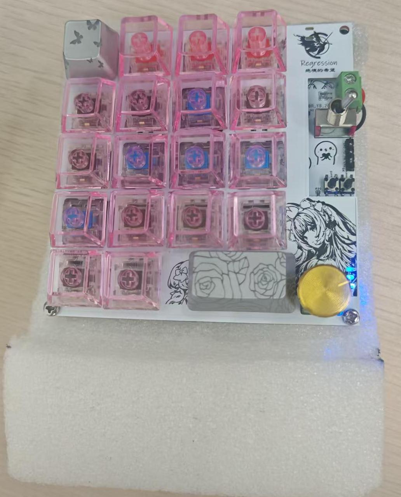
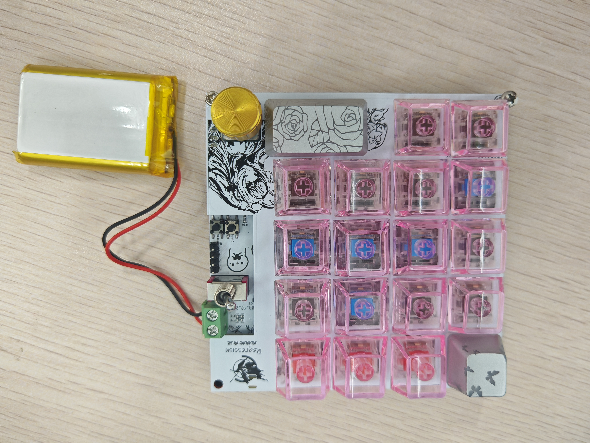
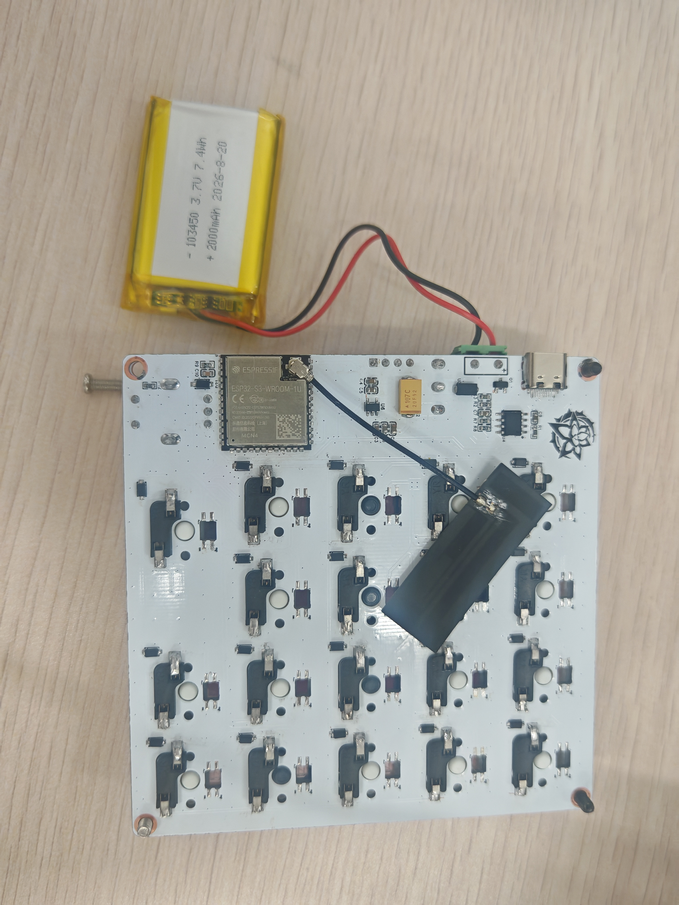
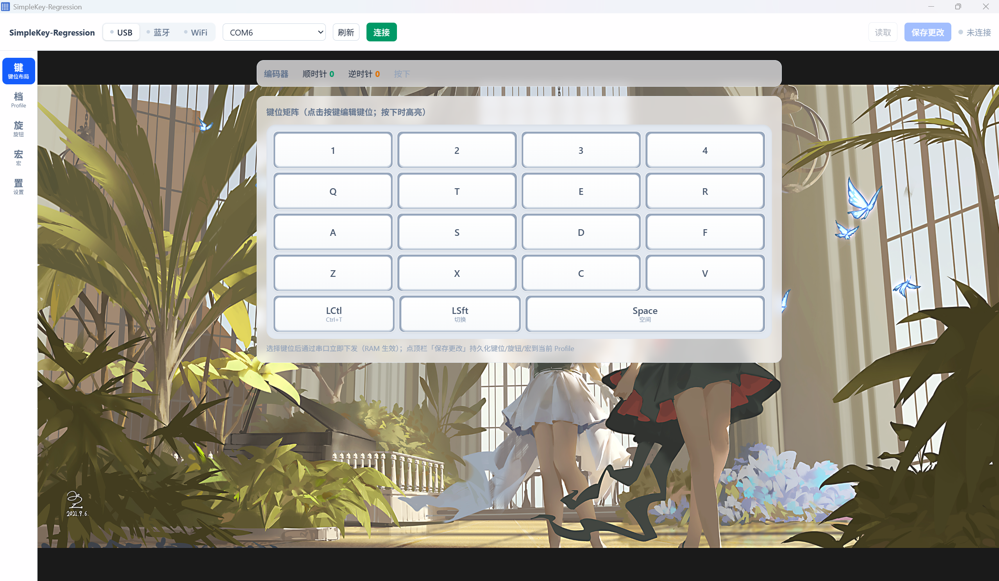

# SimpleKey-Regression —— 三模无线宏键盘

> 基于 **ESP32-S3** 的开源三模无线宏键盘：4×5 布局 19 键 + EC11 旋钮，配套桌面配置软件，VIA 风格界面。
>
> 本项目从硬件、固件到上位机均为自研，硬件制版文件与全部源码开源。
>
> 开源仓库：**https://github.com/WEN454545/SimpleKey-Regression--** ｜ 欢迎 Star / Issue / PR

<p align="center">
  
</p>

---

## 目录

- [功能特点](#功能特点)
- [硬件说明](#硬件说明)
- [外壳设计征集](#外壳设计征集)
- [上位机使用](#上位机使用)
- [固件烧录](#固件烧录)
- [文件说明](#文件说明)
- [免责声明](#免责声明)
- [许可证](#许可证)

---

## 功能特点

### 三种连接方式，一键切换

| 模式 | 说明 |
|------|------|
| **USB 有线** | 插线即用，作为标准有线键盘；插线时自动优先进 USB 模式 |
| **蓝牙** | 无线连接电脑 / 手机 / 平板，最多记住 3 台设备，换设备无需重新配对 |
| **2.4G WiFi** | 键盘自建热点，电脑连接后即插即用，游戏兼容性好 |

- 旋钮**长按**：在三种模式间循环切换，切换后自动记忆
- 运行中 LED 指示当前模式：USB=白 / 蓝牙=蓝 / WiFi=绿

### 键盘功能

- **全键无冲**：多个键同时按不丢键，游戏实测可用
- **任意改键**：每个按键都能在配置软件里改成想要的功能，即时生效
- **3 套快捷方案**：三组独立配置随时切换，旋钮按下即轮换，适合游戏 / 办公 / 媒体多场景
- **宏功能**：4 个宏槽位，支持录制与编辑，一键回放复杂操作
- **旋钮可自定义**：旋转 / 按下都能改成音量、播放、切曲等常用功能
- **电池管理**：电量显示、充电指示、低电告警、低电自动关机
- **智能休眠**：不用时自动进入低功耗睡眠，按任意键秒醒；长时间不用自动深度关机，最省电

### 配置软件

- VIA 风格界面：点开键帽就能改键，直观易用
- 键位实时测试：按键同步点亮屏幕网格
- 方案管理：三套方案独立保存、导入导出
- 宏编辑与录制：录下你的操作自动生成宏
- 电量监测：实时电量与电压曲线
- 设备维护：蓝牙配对设备管理、固件参数调整等

## 硬件说明

| 项目 | 说明 |
|------|------|
| 主控 | ESP32-S3-WROOM-1 |
| 布局 | 4×5 共 19 键（2u 空格）+ EC11 旋钮 |
| 电池 | 103450 锂电池（2000mAh，带保护板） |
| 充电 | Type-C / USB 充电，充电自动管理 |
| 指示灯 | 3 颗模式灯（白/蓝/绿）+ 充电灯（红/绿） |

<p align="center">
  
  &nbsp;
  
</p>

PCB 制版文件（Gerber）、布局文件、定位孔图均在本目录，可直接打样复刻。

## 外壳设计征集

> 键盘的电路、固件与配置软件均已完成，唯独 **3D 打印外壳还是空缺**。如果你熟悉 3D 建模（SolidWorks / Fusion 360 / FreeCAD 等），非常欢迎帮忙设计一款适配本键盘的壳体：4×5 键阵 + EC11 旋钮开孔，PCB 与定位孔尺寸见本目录制版文件（DXF / Gerber）。
>
> 方案被采用后，将在 README 与项目致谢中注明设计者，外壳模型文件也会随本项目一同开源。有意向的朋友请提 Issue 或 Pull Request 联系。

## 上位机使用

<p align="center">
  
</p>

无需安装，直接双击 **SimpleKey-Regression.exe** 即可运行（Windows 10 / 11）。

1. 用数据线连接键盘并打开软件，选择串口一键连接；或切到蓝牙 / WiFi 页面按提示连接
2. 连接后自动读取键盘当前配置，点击键帽即可改键
3. 修改完成后点「保存配置到键盘」，断电不丢失

## 固件烧录

使用乐鑫官方烧录工具 **Flash Download Tool**（[官方下载地址](https://www.espressif.com.cn/zh-hans/support/download/other-tools)），配合 USB 数据线串口烧录，无需其他环境。

**烧录文件与地址**（三个文件全部添加，均在本目录 `release/` 文件夹中）：

| 文件 | 烧录地址 |
|------|----------|
| `bootloader.bin` | `0x0` |
| `partition-table.bin` | `0x8000` |
| `SimpleKey_TriMode.bin` | `0x10000` |

**烧录步骤**：

1. 打开 Flash Download Tool，芯片类型选 **ESP32-S3**，工作模式选 UART
2. 按上表添加三个文件并填写对应地址，勾选每个文件前面的勾选框
3. 右侧设置：SPI Speed 80MHz、SPI Mode DIO、DoNotChgBin 勾选
4. 选择键盘对应的 COM 口，波特率默认即可
5. 键盘进入下载模式：**按住旋钮旁的 BOOT 键，再按一次复位键**（首次插线一般可直接识别，若识别不到再进下载模式）
6. 点击 START 开始烧录，完成后键盘自动重启

> 恢复出厂：按住旋钮插入 USB 即可清除全部配置，重新开始。

## 文件说明

```
开源/
├── README.md                       本说明文件
├── LICENSE                         GPL-3.0 许可证
├── release/                        编译好的成品（免编译直接用）
│   ├── SimpleKey-Regression.exe    配置软件（双击运行）
│   ├── bootloader.bin              固件引导文件（烧录 0x0）
│   ├── partition-table.bin         固件分区表（烧录 0x8000）
│   └── SimpleKey_TriMode.bin       键盘固件主程序（烧录 0x10000）
├── firmware/                       固件完整源码（ESP-IDF v5.4 工程，可自行编译）
├── host-app/                       配置软件完整源码（Tauri 2 工程，可自行编译）
├── hardware/                       硬件文件
│   ├── keyboard-layout.json        键盘布局文件
│   ├── Key_定位孔.dxf              定位孔机械图
│   ├── SimpleKey_第二版_*.zip      PCB 制版文件（Gerber）
│   └── SimpleKey_固定板_*.zip      固定板制版文件
└── images/                         README 图片（键盘实物与软件截图）
```

## 免责声明

- 本项目硬件与固件按「现状」提供，自行打样与烧录前请核对资料
- WiFi 模式由电脑注入键盘输入，请遵守目标软件的使用条款；因使用本项目产生的任何后果由使用者自行承担
- 锂电池存在安全风险，请使用带保护板的电芯，并遵守充电规范

## 许可证

本项目全部内容（固件源码、上位机源码、硬件设计文件、文档）以 **[GPL-3.0](./LICENSE)** 协议开源。

```
SimpleKey-Regression —— 三模无线宏键盘
Copyright (C) 2026 WEN454545

This program is free software: you can redistribute it and/or modify
it under the terms of the GNU General Public License as published by
the Free Software Foundation, either version 3 of the License, or
(at your option) any later version.

This program is distributed in the hope that it will be useful,
but WITHOUT ANY WARRANTY; without even the implied warranty of
MERCHANTABILITY or FITNESS FOR A PARTICULAR PURPOSE.  See the
GNU General Public License for more details.

You should have received a copy of the GNU General Public License
along with this program.  If not, see <https://www.gnu.org/licenses/>.
```
